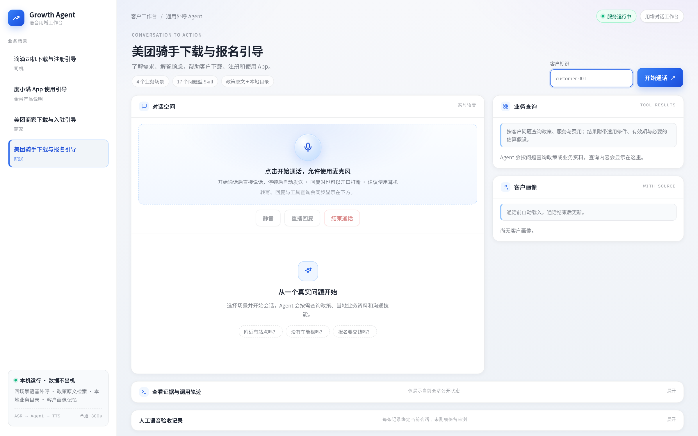
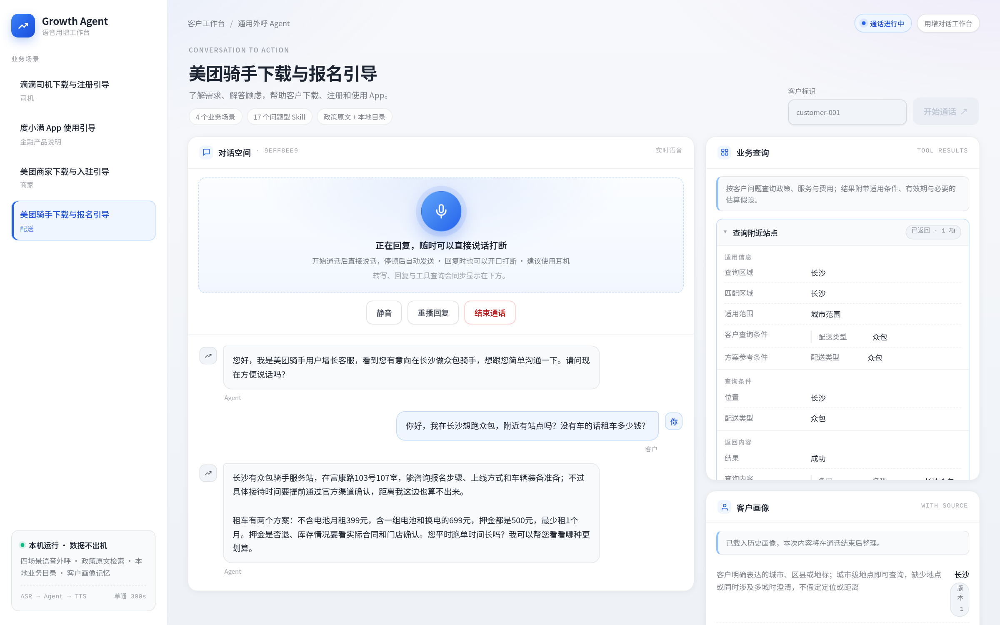
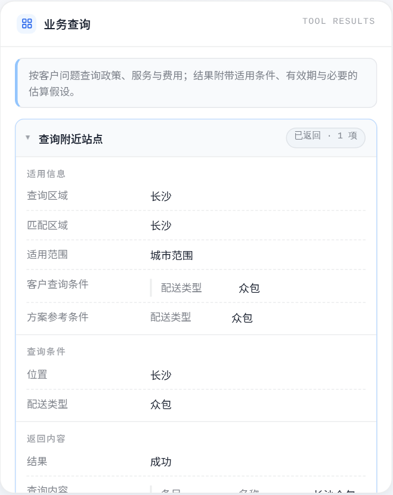
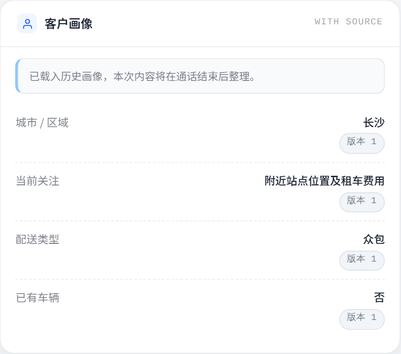
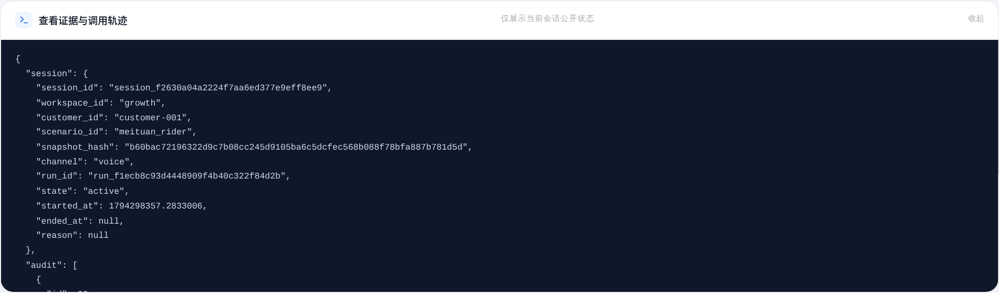

<p align="center">
  
</p>

<h1 align="center">GrowthPilot</h1>

<p align="center">
  <b>四个业务场景的语音用增 Agent</b><br/>
  听懂客户 → 查证事实 → 引导下载、注册和使用 App
</p>

<p align="center">
  
  
  
  
  
  
  
</p>

<p align="center">
  
</p>

---

**GrowthPilot 是一套跑在自己机器上的四场景语音用增 Agent，主线只有一件事：把客户的疑问变成“下载、注册、使用 App”的下一步。** 它不靠话术硬推——政策条款走本地 RAG 原文，地区、费用和联系方式走版本化业务目录，客户说过的话走画像记忆；模型只决定「何时查、怎么说」。

覆盖 **美团骑手 / 美团商家 / 滴滴司机 / 度小满** 四个场景：16 个带类型业务工具、17 个问题型 Skill、42 份冻结政策语料（1,285 个分块）、本地业务目录（60 城 / 11 类模板 / 67 个条件分支），以及 400 道 RAG 检索题与 800 通动态客户对话的离线评测。前端与后端跑在同一个本机服务上，`.env` 只保存服务端凭据。

> 截图均来自本机真实运行的页面：一轮“客户询问附近站点和租车费用”的通话，由浏览器录音 → ASR → Agent 工具查询 → TTS 播放完成。

---

## 它每次通话在做什么

<table>
<tr>
<td width="33%" valign="top">

**① 听清**

浏览器用 WebAudio + AudioWorklet 持续收音，按音量与停顿自动断句（700ms），把单次发言编码为 WAV。Agent 思考或播报时客户仍可开口插话，旧一轮立即作废。

</td>
<td width="33%" valign="top">

**② 查证**

Agent 按需调用 16 个业务工具：政策检索、地区站点/租车/计酬查询、商家费率与活动、金融费用试算。每个结果都带来源、适用条件、有效期与必要的估算假设，金额用 Decimal 确定计算。

</td>
<td width="33%" valign="top">

**③ 引导**

17 个问题型 Skill 给出不同问题的判断顺序、分支与完成条件；客户同意后发送下载短信，办妥或明确拒绝后可自然收尾。结束语必须由 `end_call` 工具登记，播放完成后才挂断。

</td>
</tr>
</table>

<p align="center">
  
  <em>真实运行截图：客户语音被转写后，Agent 查询本地站点与租车方案，在回答里保留适用条件与下一步。</em>
</p>

---

## 架构

```
┌────────────────────────────── 浏览器语音工作台 ──────────────────────────────┐
│  WebAudio + AudioWorklet 采集 → 停顿断句 → WAV 上传 → PCM 音频流边收边播      │
│  转写 / 工具轨迹 / 客户画像 / 后台任务状态实时可见，可随时插话打断             │
└───────────────────────────────────┬──────────────────────────────────────────┘
                                    │ HTTP + SSE（仅本机回环）
┌───────────────────────────────────▼──────────────────────────────────────────┐
│ FastAPI 宿主：会话生命周期 · 取消/打断 · 检查点 · 事件流 · 本地鉴权 · 静态页面  │
│        │                                                                     │
│        ├── AgentScope Agent（ReAct，最多 8 轮）──┬── Toolkit：16 个业务工具     │
│        │     系统提示 + 客户画像 + 17 个 Skill   │                              │
│        │                                        ├── 政策 RAG：42 文档 / 1,285 块 │
│        │                                        ├── 业务目录：60 城 / 11 模板   │
│        │                                        └── 确定性测算（Decimal）        │
│        ▼                                                                     │
│  PostgreSQL + pgvector：会话 / 消息 / 画像 / 审计 / 后台任务 + 政策混合索引     │
└──────────────────────────────────────────────────────────────────────────────┘
```

这条边界是刻意画的：**模型负责沟通与判断顺序，事实由工具与数据提供**。因此政策问题返回的是原文条款，费用问题返回公式、假设与“非个人报价”，客户资料只以客户原话作为证据写入画像。

---

## 能力地图

<table>
<tr>
<td width="50%"><br/><b>业务查询</b> — 政策、站点、租车、费率、活动与费用试算；结果保留条件与有效期</td>
<td width="50%"><br/><b>客户画像</b> — 通话前自动注入，通话后由独立模型提取并经原话校验后更新</td>
</tr>
<tr>
<td width="50%"><br/><b>证据与轨迹</b> — 原始会话、审计、工具调用与语音用量可追溯</td>
<td width="50%" valign="top"><b>四场景与 17 个 Skill</b><br/><br/>骑手：时间与配送模式、起步成本、租车、保障、报名材料<br/>商家：配送方式、单笔贡献、活动适配、入驻资质<br/>司机：人车准入、出勤预算、租车、报名准备<br/>金融：身份收费核验、授权辨析、费用理解、活动条件</td>
</tr>
</table>

---

## 技术栈

| | |
|---|---|
| **后端** | Python 3.11 · FastAPI · asyncio · AgentScope（固定提交，ReAct 工具循环） |
| **前端** | TypeScript · Vite · 原生 WebAudio（无框架运行时依赖） |
| **语音** | DashScope `qwen3-asr-flash`（整段识别）· `qwen3-tts-flash`（PCM 流式合成） |
| **文本模型** | OpenAI Chat Completions 兼容；按 `AGENT_* / JUDGE_* / CUSTOMER_* / PROFILE_*` 分角色配置 |
| **存储** | PostgreSQL 17 + pgvector：业务状态、客户画像、审计、RAG 索引 |
| **检索** | 本地 `BAAI/bge-small-zh-v1.5`（512 维精确余弦）+ SQL BM25 + RRF |
| **部署** | Docker Compose：应用 + PostgreSQL，命名卷持久化，`restart: unless-stopped` |
| **规模** | 16 个业务工具 · 17 个 Skill · 42 份政策文档 / 1,285 分块 · 60 城业务目录 · 4 场景 |

---

## 快速开始

### 方式一：本地开发（uv + Docker PostgreSQL）

```bash
uv sync --locked
cp .env.example .env && chmod 600 .env      # 填入文本模型与 DashScope Key
docker compose up -d --wait postgres
uv run growthpilot database init
uv run growthpilot doctor --init-secrets
uv run growthpilot validate
uv run growthpilot up --build --scenario meituan_rider
```

打开 <http://127.0.0.1:8787>，选择场景、填写客户标识，允许麦克风后直接说话。`growthpilot down` 停止应用并保留数据库。

### 方式二：Docker 持久化部署（推荐）

```bash
cp .env.example .env && chmod 600 .env      # 填 Key；POSTGRES_PASSWORD 建议换成随机值
docker build -t growthpilot:local .
docker compose up -d
```

- 应用：<http://127.0.0.1:8787>（仅绑定本机回环）
- 数据卷：`postgres_data`（业务库 + 政策索引）、`growthpilot_runtime`（向量模型缓存、日志）
- 容器：`growthpilot-app-1` 应用 + `growthpilot-postgres-1` PostgreSQL；两者 `restart: unless-stopped`
- 常用命令：`docker compose ps / logs -f app / restart app / down`（`down` 不会删除数据卷）

> 默认使用标准镜像 `pgvector/pgvector:pg17`（当前部署即此镜像，pgvector 0.8.7）。
> 若本机拉取 Docker Hub 受限，可临时在 `.env` 设置 `POSTGRES_IMAGE` 指向本地已有的
> PostgreSQL 17 + pgvector 镜像（例如 `paradedb/paradedb:latest-pg17`）。

---

## 配置模型

文本模型按用途拆成四组环境变量，连接项留空时沿用 `AGENT_*`；也可以让不同角色使用不同厂商：

| 前缀 | 用途 | 说明 |
|---|---|---|
| `AGENT_*` | 业务对话 Agent | 必须支持流式输出、函数工具调用与工具结果续接 |
| `JUDGE_*` | 对话质量评审 | 需要 JSON 对象输出；跨厂商评审可减少同族偏好 |
| `CUSTOMER_*` | 评测中的模拟客户 | 需要 JSON 对象输出 |
| `PROFILE_*` | 通话后画像提取 | 需要 JSON 对象输出 |
| `DASHSCOPE_*` | ASR / TTS | 语音服务独立于文本模型，填 `DASHSCOPE_API_KEY` 与域名根地址 |

```dotenv
AGENT_API_KEY=...
AGENT_BASE_URL=https://api.deepseek.com
AGENT_MODEL=deepseek-flash
AGENT_EXTRA_BODY='{"thinking":{"type":"disabled"}}'

DASHSCOPE_API_KEY=...
DASHSCOPE_BASE_URL=https://dashscope.aliyuncs.com
ASR_MODEL=qwen3-asr-flash
TTS_MODEL=qwen3-tts-flash
TTS_VOICE=Cherry
```

切换厂商时按整组替换 `EXTRA_BODY`、温度与 token 参数；`uv run growthpilot doctor --online` 只检查文本连通性，工具循环与业务质量仍需对话验证。完整配置说明见[文档导航](docs/README.md)与[排障](docs/troubleshooting.md)。

---

## 评测与质量

正式评测只有两类：**RAG 检索**与**动态客户文本对话**。它们与本机语音链路分开统计，离线成绩不代表真实客户转化。

| 评测 | 规模 | 已归档结果 |
|---|---|---|
| RAG 检索 | 4 场景 × 100 题 = 400 | Recall@8 **87.1%** · MRR@8 **0.8524** · Precision@8 19.8%；分场景 Recall@8：骑手 93.4% / 商家 86.3% / 滴滴 89.8% / 金融 79.0% |
| 动态客户对话 | 400 客户 × 每人 2 通 = 800 通 | 799 通取得有效评分；观察均分：目标完成 **4.69** / 问题解决 **4.68** / 事实可靠 **4.54** / 沟通体验 **4.86**（1–5 分）；每通平均 48,156 tokens；首 token 时延 P50 **2.02s** / P95 **6.57s** |

> 该轮全量运行的原始状态是 `incomplete`：1 通模拟客户输出异常，另有 3 通画像提取在重试后失败；原记录保留，异常客户另行补跑，未与主轮混成总均分。结果报告、低分案例与完整 trace 见 [evaluation/reports/](evaluation/reports/README.md)。

```bash
# 工程回归（需要真实 PostgreSQL + pgvector）
uv run pytest -q                              # 1,191 passed, 12 skipped
npm --prefix frontend test                    # 38 passed
npm --prefix frontend run build               # tsc + Vite 构建
uv run growthpilot validate
uv run python -m evaluation.checks.contracts --output .run/checks/growth-contracts.json
uv run python -m evaluation.checks.business_coverage --output .run/checks/growth-business-coverage.json

# 评测预览 / 显式执行
uv run growthpilot evaluate --suite rag --scenario meituan_rider --limit 3 --run rag-preview
uv run growthpilot evaluate --suite dialogue --scenario meituan_rider --limit 3 --execute
```

真实模型的 12 项 live 测试默认跳过；设置 `GROWTH_RUN_LIVE=1` 才会调用云端模型与语音服务。

---

## 主线模块

| 模块 | 职责 | 入口 |
|---|---|---|
| `backend/scenarios/` | 四场景身份、目标、可记忆字段、工具与 Skill 声明 | [scenario.yaml](backend/scenarios/meituan_rider/scenario.yaml) |
| `backend/agent_harness/` | Agent 装配、对话生命周期、工具边界、Skill 加载、事件观察 | [conversation.py](backend/agent_harness/conversation.py) |
| `backend/agent_harness/tools/` | 16 个带类型业务函数与工具边界（权限、超时、审计、模型结果投影） | [tools/README.md](backend/agent_harness/tools/README.md) |
| `backend/agent_harness/business_data/` | 版本化业务目录、地区解析、模板生成、确定性费用计算 | [business_data/README.md](backend/agent_harness/business_data/README.md) |
| `backend/agent_harness/rag/` | 固定教学语料校验、采集、清洗、分块、pgvector + BM25 混合检索 | [rag/README.md](backend/agent_harness/rag/README.md) |
| `backend/agent_harness/memory/` | 画像冻结注入、通话后异步提取、证据校验、版本与 TTL | [memory/README.md](backend/agent_harness/memory/README.md) |
| `backend/api/` + `backend/channels/` | 本机 HTTP 接口、静态页面、ASR/TTS 适配 | [app.py](backend/api/app.py) |
| `frontend/` | 语音工作台：录音断句、PCM 播放、打断、工具轨迹与画像展示 | [frontend/README.md](frontend/README.md) |
| `evaluation/` | RAG 与动态对话评测、裁判、报告、工程检查 | [evaluation/README.md](evaluation/README.md) |
| `backend/cli.py` + `migrations/` | 启动、校验、知识库、评测、回放、清理与数据库迁移 | [cli.py](backend/cli.py) |

---

## 这个仓库里没有的东西

- **不是生产客服系统**：本项目是教学成品，只在本机回环地址运行，按单个应用进程设计。
- **没有真实业务接口**：业务目录是版本化演示数据，不是品牌实时库存、报价或订单系统；短信为本地模拟发送。
- **联系方式是教学占位**：目录中的地址与电话形如 `000-XXXX-XXXX` 且标记 `phone_dialable: false`，不可拨打或到访；接入真实数据源需要替换只读适配器。
- **没有线上转化数据**：评测来自模拟客户与离线题集，不能当作真实用户转化率或业务承诺。
- **没有模型训练与微调**：所有模型能力来自外部 OpenAI 兼容服务与本地嵌入模型。

## 运行与安全边界

- 服务只绑定 `127.0.0.1`，并校验 Host / Origin / 回环来源；Docker 部署通过端口映射到本机 `8787`。
- `.env` 保存服务端密钥，权限应为 `600`，不要提交到版本库；会话使用按会话派生的 Bearer token。
- 语音链路需要 DashScope 凭据；没有语音 Key 时仍可使用文本评测与工程检查。
- 本项目采用 [MIT 许可](LICENSE)；第三方依赖与资料见[上游资源归属](docs/third_party/README.md)。
