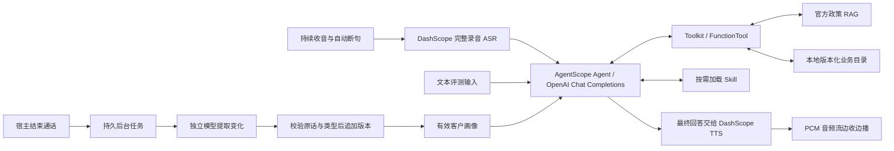

# 用增对话 Agent 架构

`Conversation.message()` 是统一业务输入路径。语音转写完成后，宿主保存最终文本和消息 ID，再调用 Agent；文本评测直接输入客户消息。开场 `host_control` 用于启动沟通，不能作为客户原话写入 Memory。

浏览器用 WebAudio 与 AudioWorklet 持续采集麦克风，依据音量和停顿判断发言边界，将单次发言编码为 WAV 交给现有 ASR。Agent 生成最终回答后，后端通过 HTTP SSE 接收 TTS 的 PCM 片段并传给浏览器，浏览器边收边播。ASR 等待完整录音识别，AgentScope 内部消费模型流式响应，但宿主仍等待最终回答后才调用 TTS；语音边收边播指的是 TTS 音频。

Agent 自主选择解释、澄清、政策检索、业务查询和下载短信发送，AgentScope 执行工具循环。`FunctionTool` 根据函数类型和说明生成参数 Schema；业务函数仅按场景声明注册，系统通话工具由宿主统一提供。Skill 的名称和描述先可见，正文按需读取；加载 Skill 不扩大工具权限。

## 模型配置与调用边界

业务 Agent 使用 AgentScope 的 `OpenAIChatModel`，画像提取、模拟客户与评审使用 OpenAI SDK，全部调用 Chat Completions。`backend/llm.py` 统一组装生成参数；`backend/settings.py` 将环境变量与 `backend/config/models.yaml` 合并。模型按用途划分为 `AGENT_*`、`PROFILE_*`、`CUSTOMER_*`、`JUDGE_*`，各自可配置密钥、地址、模型和生成参数，默认模型是 `deepseek-flash`。

辅助角色未指定的连接项沿用 Agent；改用不同 API 地址时必须同时提供该角色的密钥。温度、输出预算、token 参数名、推理强度和扩展参数按角色独立配置，不因共用连接而继承。供应商特有能力通过各角色的 `EXTRA_BODY` 显式传入；YAML 默认不发送 `thinking` 或 `reasoning_effort`，调用代码也不按厂商名字分支。`.env.example` 显式配置 DeepSeek 的 Agent、客户、画像提取关闭思考，裁判开启 high 思考；切换服务时应一起替换这些参数。切换 DeepSeek、GPT、Qwen 的完整示例见[启动与模型配置](../README.md#按用途配置和切换文本模型)。

兼容范围取决于具体接口能力：Agent 使用流式响应、工具调用和工具结果续接，画像提取、模拟客户与评审使用 JSON 对象输出模式。只提供 Responses API 或纯文本生成的服务不能直接承担这些调用。语音识别与合成继续由独立的 DashScope 配置驱动，不随文本模型切换。

## 四类信息的职责

客户画像按工作空间、客户和场景隔离，字段由 `customer_fields` 定义。通话创建时冻结有效画像，自动注入系统上下文；本次最新表达优先。通话结束时提交 `profile_jobs`，后台模型结合旧画像和完整对话提取变化，代码校验并更新版本。画像更新不占用实时 Agent 的工具调用；失败与重启恢复见 [画像实现](../backend/agent_harness/memory/README.md)。Skill 描述沟通和查询方法。政策 RAG 提供实际取得的官方原文。`BusinessCatalog` 按地区与业务条件筛选本地目录，计算费用并返回有效期、采用条件和查询结果。下载短信工具从会话取得客户与场景，保存发送回执；同一会话重复调用复用原结果。

业务查询优先精细地区记录，其次城市配置，最后使用通用方案。城市级输入可以直接查询；通用方案支持未收录地区。原始请求与实际采用条件分开保存，避免把未知条件当成已有事实。目录来源、匹配过程和生成标记保留在内部审计，模型结果保留方案、联系人、金额、条件和必要估算假设。

客户反馈下载或注册完成后，Agent 可以继续指导使用。客户自述不等于后台核验；通用方案也不能证明个人资格、合同费率或实际收入。

业务状态与政策索引统一存入 PostgreSQL：前者包含会话、消息、画像版本和后台任务，后者使用 pgvector 向量及词频 BM25。数据库 schema 隔离应用与评测的业务状态，RAG namespace 隔离运行时与冻结评测语料。原文快照和模型缓存继续保存在本地文件中。连接池、表结构版本管理和备份见[数据库说明](database.md)。

## 生命周期与可观察性

宿主负责通话开始、超时、停止当前请求、结束和资源释放。Agent 的普通回复保持纯文本；调用系统通话工具 `end_call(message)` 时，宿主直接将参数中的结束语保存并交给 TTS，无需额外调用模型生成告别。框架沿用本地收尾流程保存回复与工具记录，这些本地事件不产生模型用量。前端等待结束语实际播完再结束通话，期间插话会撤销结束请求；普通回复完成不会挂断。检查点在正常和异常退出路径中保存。

语音应用仍由单个宿主管理内存中的会话与音频状态。PostgreSQL 迁移改善持久化和事务表达，不会自动提供会话跨进程路由或分布式恢复；当前启动方式保持一个应用进程。

用户开口插话时，浏览器先清空播放队列，再调用 `/api/sessions/{sid}/voice/interrupt` 停止旧一轮的 Agent 回答和 TTS，继续收音。每轮请求带编号，已取消轮次的迟到回复不再播放。完整回复音频只在当前通话缓存，重播复用缓存；合成失败时可只重试 TTS。

`events.py` 观察原生框架事件，记录工具调用、结果与最终回复。业务查询一次返回完整结果，异常保留失败原因。前端显示转写、工具轨迹、客户画像和后台任务状态；TTS 只接收已保存的最终回复，失败后可单独重试。

正式评测分为 RAG 检索与文本 Agent 两条路径。动态客户由 `CUSTOMER_*` 配置的独立模型会话扮演，`JUDGE_*` 配置的评审模型在对话结束后判定案例目标和逐轮事实依据，代码统计平均 Agent token。客户设定与评分目标分别传入客户模型和 judge，不进入业务 Agent 上下文。完整链路保留 Memory 与 Skill，工程测试和语音试听另行记录。学习顺序见[评测说明](../evaluation/README.md)。

代码入口见[源码地图](code-map.md)，验证流程见[当前验证流程](current-validation.md)。
